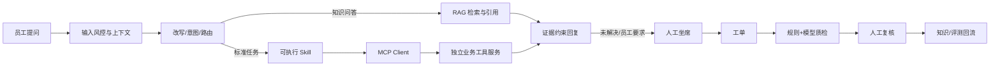

# 12345客服联盟 FDE求职Demo重设计方案

## 1. 方案定位

这是一套**可公开访问、可从 GitHub 复现的企业内部智能客服产品演示系统**。故事主线是员工自助、坐席协同、工单跟进、服务质检和知识改进。演示业务数据全部为合成数据，但对话中的模型推理、RAG 检索、Skill 执行、MCP 工具调用、后端权限校验与状态持久化都应真实运行。

求职展示应突出三种能力：一是从员工、坐席、质检员的工作痛点定义产品；二是把模糊需求落成可运行的集成方案；三是用证据、权限、评测和日志说明系统如何可靠工作。项目表述应准确称为“基于合成业务数据实现的端到端原型”，不宣称接入腾讯或真实企业系统，也不把课件中的业务数字写成本项目成效。

**主打演示问题：**“我的报销怎么还没到？”员工先获得知识解释，再通过本人身份查询模拟报销系统的实时状态；若存在异常，携带上下文转人工，坐席生成工单并解决；工单关闭触发质检，质检员复核后将问题送入知识维护或评测集。这条链路要能在一次面试演示中完整走通。

## 2. 参考材料与产品取舍

| 来源 | 提炼出的要求 | 在新 Demo 中的落点 |
| --- | --- | --- |
| `【PRD】12345客服联盟 _ 智能客服.docx` 第三至五章 | 九类业务、服务前中后、Query 风控与改写、意图路由、RAG、槽位、记忆、Skill、人工协同、单工单质检 | 保留业务分类和四个主工作台；把原有前端模拟链路替换为后端可追踪执行 |
| 同一 PRD 第六至十章 | 评测集、Bad Case、日志埋点、版本演进、角色演示 | 增加运行轨迹、评测面板与可复现的失败案例；保留角色切换 |
| 腾讯智能客服课件 01/02 与两份纪要 | 服务前中后分层；混合检索、父子切块、坐席摘要与填单、MCP、Skills SOP、规则加模型质检 | 采用一个受控 Agent 加可执行 Skill 和独立 MCP 服务；建设带版本的知识检索和证据链 |
| Accio Work 参考图 | 左侧任务入口、醒目的对话输入区、可发现的专家能力、专家配置预览 | 借鉴信息架构与交互层级；采用自己的品牌、业务文案和组件设计 |

**范围控制：**九类业务先有可检索的知识入口；真正的工具执行聚焦“报销进度查询”和“IT 报修申请”两类。复杂跨工单质检异常分析作为第二个可展示的 Agent 场景。这样既能呈现广度，也有足够深度验证真实调用。

## 3. 用户角色与页面设计

### 3.1 全局导航

左侧固定导航采用深色工作区风格：`新对话`、`智能服务`、`坐席工作台`、`工单中心`、`质检平台`、`知识与评测`。顶部展示当前角色、演示数据标识、模型运行状态与“查看本次轨迹”入口。公共访客可以选演示身份，但后端仍按身份执行角色与数据权限。

**角色：**员工只能看本人会话和工单；坐席看授权队列；质检员看质检任务及相关证据；管理员可看脱敏运行轨迹、知识版本和评测结果。角色切换会创建新的后端会话，不能仅靠前端隐藏菜单。

### 3.2 智能服务对话页

- **空状态：**参考 Accio 的居中输入区与任务卡，展示“报销进度”“IT 报修”“请假政策”“人工帮助”四个快捷入口。不要复制其 Logo、头像或“专家市场”文案。
- **对话态：**左侧历史会话；中间消息流、引用来源和状态卡；右侧可折叠的“本次处理”面板。回复区将知识回答、业务查询结果、用户待确认动作分成不同卡片。
- **明确状态：**“已查到本人单据”“需要选择具体单据”“资料不足需澄清”“已提交报修并返回单号”“查询失败/状态未知”。跳转链接只能标为“办事入口”，不能标为已办理。
- **透明但不过载：**默认只显示“正在查询知识/调用报销系统”等步骤；展开后可看脱敏的意图、路由、Skill、MCP 工具名、耗时、引用 ID 和 trace_id。不要暴露系统提示词或原始敏感参数。
- **专家卡片：**仅将真实可用的业务能力呈现为“报销助手”“IT 服务助手”“政策问答”。管理员可进入只读“能力配置”页查看说明、可用 Skill、工具权限和知识范围；不提供公开的任意 Agent 创建入口。

### 3.3 坐席工作台

三栏布局：左侧队列与 SLA；中间员工对话和坐席回复；右侧 AI 摘要、知识推荐、回复草稿、工单预填。转人工时自动携带员工问题、已尝试步骤、工具结果和转接原因，避免员工重复描述。坐席可采纳、修改或拒绝 AI 建议；回复发送、业务承诺和工单提交由坐席确认。预填字段显示来源与置信度，缺失必填项和证据冲突高亮。

### 3.4 工单中心

列表支持按状态、业务域、优先级和 SLA 筛选；详情页把会话、处理记录、业务回执、责任人和时间线关联起来。状态约束为待受理、处理中、已解决、已关闭；关闭后触发正式质检草稿。员工看到本人进度，坐席与管理员看到各自授权范围。

### 3.5 质检平台

将“单工单质检”和“跨工单异常分析”分成两个标签。单工单报告按**事实、流程、态度**展示规则结果、模型判断、原文证据、规则版本和不确定项；质检员逐项确认或修改，坐席可申诉，整改后可复检。异常分析页可提问“最近两周报销类工单不合格率为什么上升”，展示 Agent 的调查计划、分组指标、抽样证据、原因假设和报告草稿；结论由负责人复核。

### 3.6 知识与评测页

知识页展示文档来源、业务域、适用对象、发布时间、有效期、版本、审核状态与原文定位。评测页展示固定案例集的运行结果、失败环节和 Bad Case 回流。面试演示时能从一次错误回复跳到对应 trace、知识版本或工具失败记录，形成“发现问题、定位原因、更新、回归验证”的完整故事。

## 4. 核心交互流程



### 4.1 服务前

服务端按顺序处理：身份与权限注入、输入风控、必要的 Query 改写、多意图识别、路由、知识检索或 Skill 执行、证据约束回复、输出检查。高置信标准问答可以走较短路径；复杂问题进入有限步数的 Agent 规划。模型只提出动作，**服务端独立检查**身份、工具允许列表、输入 Schema、业务条件和用户确认。

### 4.2 服务中

转人工事件冻结交接摘要和证据引用；队列接单后坐席可查看原始会话。AI 摘要、知识推荐和工单预填在后端生成并存版本。工具返回失败、权限拒绝、模型不确定时，坐席可手动补充，不把失败结果包装为成功。

### 4.3 服务后

工单提交时做字段完整性检查；关闭后触发质检草稿。确定性项目用规则判断，例如必填、SLA、操作顺序、工单字段与业务回执一致性；语义项目由模型提示疑似态度问题并定位原文。严重风险、证据冲突和低置信项优先人工复核；AI 初检不能直接作为处罚结论。

## 5. 技术架构与选型

| 层 | 推荐选型 | 选择理由与边界 |
| --- | --- | --- |
| 前端 | React + TypeScript + Vite；TanStack Query；React Router；Tailwind CSS 或 CSS 变量组件体系 | 易构建高质量交互和状态卡，类型化 API，保留演示体验 |
| 后端 API | Python FastAPI + Pydantic + SQLAlchemy + Alembic | 熟悉的 HTTP/Schema/数据库边界，适合对接模型和 MCP；流式输出可用 FastAPI 的 `StreamingResponse` [官方文档](https://fastapi.tiangolo.com/advanced/stream-data/) |
| Agent 编排 | LangGraph 状态图，只在复杂任务中使用；简单路径用确定性服务函数 | 支持状态持久化和人工中断；使用 PostgreSQL checkpointer 承载可恢复任务 [官方参考](https://reference.langchain.com/python/langgraph.checkpoint) |
| 模型接入 | 自有模型适配层 `ModelGateway`，配置 `base_url/api_key/model_id`；主模型需通过工具调用、结构化输出、中文与流式能力验收 | 不在产品设计中假定某个订阅一定含 API 额度；服务端保管密钥，前端不接触 |
| 业务存储 | PostgreSQL + pgvector；可选 Redis 用于短时缓存与队列 | 会话、工单、质检、日志同库存储；向量检索可与 PostgreSQL 全文检索组合 [pgvector 官方说明](https://github.com/pgvector/pgvector/blob/master/README.md) |
| MCP | 官方 Python SDK；Agent 进程为 MCP client，独立业务工具进程为 MCP server | 本地开发可用 stdio，部署用 Streamable HTTP；调用必须经过协议的 `list_tools/call_tool`，不是同进程函数伪装 [SDK 文档](https://github.com/modelcontextprotocol/python-sdk/blob/main/docs/run/index.md) |
| 部署 | Docker Compose + Caddy + Linux 云主机 | 前后端、MCP、数据库容器化；单机部署足以支撑面试演示 [Compose 生产指南](https://docs.docker.com/compose/how-tos/production/) |

首版不要同时引入 Elasticsearch、Kafka、微服务网关和多个 Agent 框架。业务证据规模较小时，PostgreSQL 加 pgvector 已足够做可评测的混合检索；后续若中文关键词检索质量不足，再基于评测结果增加专用搜索引擎。中文词法召回可先对标题、别名、正文做分词并索引；向量与词法结果用 RRF 融合，再按版本、适用范围与权限过滤、重排。

### 5.1 服务边界

```text
Browser  ──HTTPS──>  Caddy
                     ├─ 静态前端
                     └─ /api/* ──> FastAPI ──> PostgreSQL/pgvector
                                         ├─ ModelGateway ──> 外部模型 API
                                         ├─ Agent/Skills
                                         └─ MCP Client ──> 内网 MCP Server ──> 合成业务系统数据
```

MCP server 只在容器私网开放；公网只暴露前端和 `/api`。对外模型 API 出站访问要在部署区域实际验证，尤其关注中国大陆访问稳定性。若主要面试官在国内，可优先选择网络可达的云主机和模型提供商。

## 6. Agent、Skill 与 MCP 的真实能力设计

### 6.1 两个 Agent 场景

**员工服务 Agent：**根据意图在知识回答、报销查询、IT 报修、转人工之间选择路径。状态包含原始诉求、改写结果、业务域、槽位、授权身份、证据、执行结果、预算和待确认动作。最多执行有限轮工具调用；遇到权限拒绝、超时或未知状态停止并告知用户。

**质检异常分析 Agent：**只读访问工单及指标数据，制定调查计划，按业务域、时间和问题类型分组，抽取证据，形成“已确认事实、待验证假设、改进建议、限制”四段报告。每个事实必须链接至工单、规则或统计查询。最多若干步调查，复核要求可恢复任务。此场景体现规划与反思，但不自动修改业务规则。

### 6.2 首批可执行 Skill

| Skill | 输入与步骤 | 输出与异常 |
| --- | --- | --- |
| `reimbursement-status` | 识别“本人进度”意图；列出授权单据；多单据时请用户选择；再查详情 | 返回当前节点、状态、下一步和业务回执；无单据、无权限或超时各有独立状态 |
| `it-repair-request` | 收集设备、故障、地点、联系方式；展示确认卡；用户确认后提交 | 返回报修单号；使用幂等键，超时先查询原请求状态 |
| `ticket-qc-report` | 读取工单、会话、日志和规则版本；执行确定性检查；模型分析语义问题 | 带证据定位的报告草稿；缺证据标“无法判定” |
| `qc-anomaly-report` | 固定指标口径、制定查询计划、按需抽样、记录假设和证据 | 可复核分析草稿；预算耗尽保留未解决项 |

每个 Skill 在仓库内包含说明文件、版本、输入/输出 Schema、执行代码、允许调用的工具、错误映射和测试案例。说明文件描述 SOP，运行时代码真正执行流程；不能只放 `SKILL.md` 让模型自由发挥。高风险写入步骤在 Skill 内暂停等待用户确认，并由后端再次校验。

### 6.3 MCP 工具清单与调用证明

独立 `business-mcp` 服务至少提供：`list_my_reimbursements`、`get_reimbursement_detail`、`get_my_leave_balance`、`get_ticket_timeline`、`create_it_repair_ticket`、`get_it_repair_request_status`、`query_qc_metrics`、`get_qc_evidence`。每个工具有清晰 description、JSON Schema、角色权限、超时和结构化错误码。写入工具必须带 `actor_id`、`confirmation_token` 和 `idempotency_key`；这些值由后端下发和验证，不能信任模型生成。

演示轨迹中可查看：`trace_id → Skill 版本 → MCP server 名 → tools/list 结果 → tools/call 名称与脱敏参数 → 调用耗时 → 结构化返回 → 最终回复引用`。这条轨迹是“真实 MCP”最有说服力的证明。MCP 工具输出是外部数据，不当作系统指令执行。

## 7. 知识库与数据模型

首批准备 40–80 条脱敏、合成的政策/FAQ/流程资料，覆盖 PRD 的九类业务：IT、HR、WeLink、报销审核、差旅、供应、采购、政务、信息安全。高频报销和 IT 场景增加完整长文、表格和新旧版本冲突样本。文档入库保留原文与解析结果，按标题、段落、表格行切块，记录父文档/子块关系。每条知识都带业务域、适用人群、发布状态、生效与失效时间、版本、来源和审核人。未发布或过期内容不进入员工回答。

主要表：`users/roles`、`sessions/messages`、`agent_runs/steps`、`tool_calls`、`skills/skill_versions`、`knowledge_documents/chunks`、`tickets/ticket_events`、`qc_reports/reviews/appeals`、`eval_cases/eval_runs`。所有可追溯对象包含 `trace_id` 和版本字段。业务数据用 seed 脚本可重置；公共 demo 不写入真实个人信息。

API 最小集合：`POST /api/chat/runs`、`GET /api/chat/runs/{id}/events`（SSE）、`POST /api/chat/runs/{id}/confirm`、`POST /api/handoffs`、`GET/POST /api/tickets`、`GET/POST /api/qc-reports`、`GET /api/traces/{id}`、`POST /api/evals/run`。前端以生成的 OpenAPI 类型对接后端。

## 8. 权限、稳定性与可观测性

- **权限：**后端鉴权与 RBAC，员工查询工具强制按登录身份过滤；详情再次验证归属。模型提出越权参数时工具拒绝，回复不编造结果。
- **输入输出：**提示词注入、敏感字段与越权请求先分类处理；知识和 MCP 结果均作为不可信数据引用；回复只能基于授权证据。日志按字段脱敏。
- **状态：**写入动作双重确认并使用幂等键；超时区分“失败”和“结果未知”，结果未知先查回执再决定是否重试。
- **预算：**每个任务限制模型调用次数、工具步数、超时时间和 Token/费用；公共访客按 IP/会话限流，异常时优雅转为“回放演示模式”，并明显标注此时不是真实推理。
- **观测：**统一 trace_id 贯穿浏览器事件、API、模型、Skill、MCP 与数据库；记录阶段耗时、Token、工具成功率和错误码。原始提示词与敏感参数不在公共页面展示。

## 9. 指标与评测验收

**业务指标要先写清口径。**自助率按 PRD 的有效问题单元统计，不把“只返回跳转入口”计为已办理；转人工后该单元不算自助解决。另看首轮有效答复率、查询成功率、转人工携带上下文完整率、坐席知识采纳率、工单预填采纳率、质检疑似问题确认率、误报率和整改完成率。演示系统的样本量小，仪表盘应标“合成数据/演示口径”，避免把数字当真实业务收益。

固定评测集从 50–100 条高质量样本起步，包含标准问答、含否定表达、多意图、权限拒绝、过期知识、工具超时、重复提交和质检证据缺失。评测分层执行：规则检查意图、路由、权限、工具选择、参数、写入次数与业务状态；模型评分只用于开放式回答的清晰度和完整性。每次改提示词、知识版本、Skill 或模型时跑同一批回归，保存旧版/新版对比和 Bad Case 原因。

必须能现场演示的四个反例：`“先别提交，只告诉我流程”不能触发写入`；`查同事报销单必须拒绝`；`工具超时不能说已提交`；`过期制度不能被引用为现行规定`。这四例比一个漂亮但不可验证的总分更有面试价值。

## 10. 部署与 GitHub 交付

### 10.1 仓库结构

```text
12345-service-alliance/
├─ apps/web/                 # React 前端
├─ apps/api/                 # FastAPI、Agent、Skill 执行器
├─ apps/business-mcp/        # 独立 MCP server
├─ packages/contracts/       # OpenAPI/Schema 或共享契约
├─ data/seed/                # 合成工单、会话、知识、评测集
├─ docs/                     # PRD映射、架构、演示脚本、ADR
├─ infra/                    # Dockerfile、Compose、Caddy、迁移
└─ .github/workflows/        # lint、测试、镜像构建与部署
```

### 10.2 本地与公网部署

本地用 `docker compose up` 启动前端、API、MCP、PostgreSQL；`.env.example` 只给变量名，真实密钥不进 Git。单机公网方案采用 Linux 云主机、域名与 Caddy。Caddy 提供 HTTPS 并反向代理前端和 `/api`，[官方文档](https://caddyserver.com/docs/automatic-https)说明其自动证书能力。数据库与 MCP 端口仅在 Compose 私网。模型 API Key 用服务器密钥文件或云平台 Secret 注入，Compose 支持按服务挂载密钥 [官方文档](https://docs.docker.com/compose/how-tos/use-secrets/)。

CI 流程：前后端检查与测试 → 构建镜像 → 推送镜像仓库 → 在测试环境执行数据库迁移和冒烟测试 → 发布到演示域名。保留上一个镜像标签与数据库备份，失败时回滚。部署前验证 SSE 在反向代理下不断流、模型提供商在服务器地区可达、重启后会话和工单仍在、公共访客无法访问其他角色数据。建议初始机器资源按外部模型调用、单机 Postgres 和低并发演示估算，压测后再定规格，暂不承诺具体价格。

### 10.3 面试访问体验

首页放“3 分钟体验”按钮，一键载入合成案例和演示身份；另有“查看架构/运行轨迹”和 GitHub 链接。若模型服务不可用，页面清楚提示“在线能力暂不可用”，可切换到带标识的录制回放，不把回放伪装成实时模型执行。设置每日 API 预算和限流，避免公开链接消耗密钥额度。

## 11. 分期实施与完成标准

| 阶段 | 交付 | 完成标准 |
| --- | --- | --- |
| 1. 基础系统 | React 设计体系、FastAPI、PostgreSQL、角色登录、合成数据、工单状态机 | 四个角色的页面与 API 权限正确；数据重置可复现 |
| 2. 真实服务前能力 | 模型适配、知识入库与混合检索、报销查询 Skill、MCP server、SSE 轨迹 | 一次员工提问确实触发 MCP `tools/call`，返回业务状态和引用 |
| 3. 服务中后闭环 | 转人工交接、坐席辅助、工单、单工单质检、复核申诉 | 从员工问题到人工确认质检能连续走通，所有状态持久化 |
| 4. 求职展示加固 | 质检异常分析 Agent、评测集、Bad Case、Docker 公网部署、演示脚本与 README | 公网可访问，GitHub 可复现；四个反例测试通过；日志能解释每次关键决策 |

对单人开发，建议先用 6–8 周完成前 3 阶段并上线，再安排 1–2 周打磨异常分析、评测与求职材料。若时间不足，优先保住一条端到端真链路，不以增加页面数量替代系统可靠性。

## 12. 面试讲述与简历表达

演示顺序控制在 8–10 分钟：1 分钟讲业务问题和角色；3 分钟跑员工报销查询与真实 MCP 轨迹；2 分钟展示坐席交接和工单；2 分钟展示质检证据与人工复核；最后用 1–2 分钟展示权限拒绝或工具超时的 Bad Case、评测对比和部署架构。重点解释做过的取舍：哪些步骤用规则、哪些用模型、为什么选 Skill、为什么 MCP 独立部署、失败如何恢复。

简历可写实际完成的事实，例如“设计并实现覆盖员工自助、坐席协同、工单质检的全栈演示系统；基于真实模型 API、可执行 Skill 和独立 MCP 服务完成报销查询/IT 报修流程；建立带引用、版本和 trace_id 的评测与审计链路”。上线后再用真实测得的延迟、准确率和测试覆盖替换占位描述；不要预写未验证的提升百分比。

## 13. 关键待确认项

进入实现前只需确认三个会改变工程方案的信息：**模型提供商、API 可用模型与计费方式**（订阅不一定包含 API 额度）；**目标访问地区与云主机预算**；**是否允许公开访问带写入能力的合成业务系统**。即使这些尚未确认，以上架构仍可先按本地模型适配接口、私有 MCP 和只读公网体验设计。
